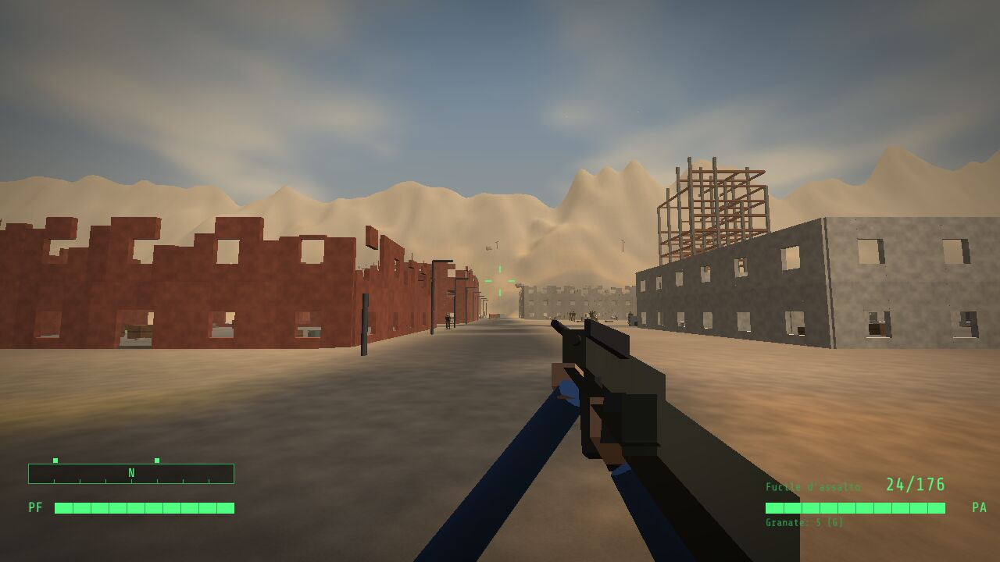
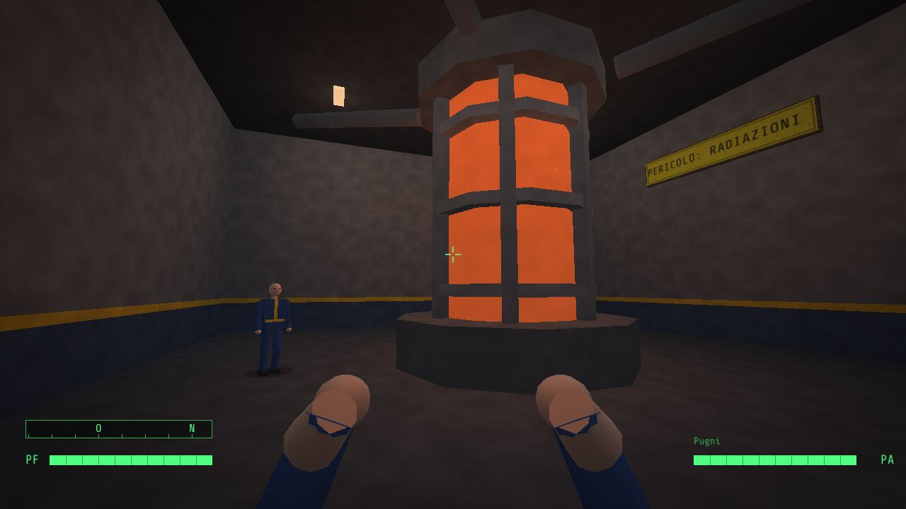
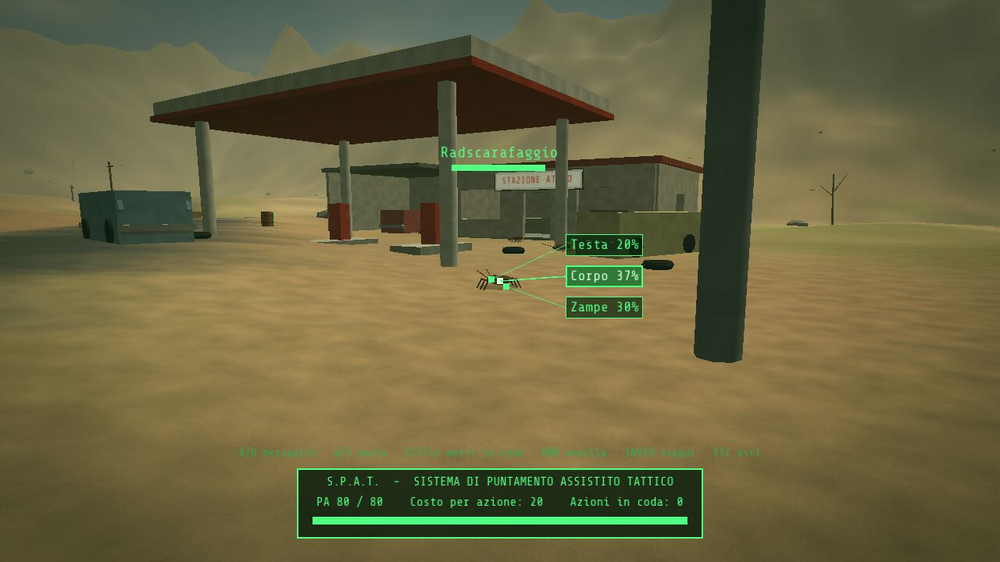
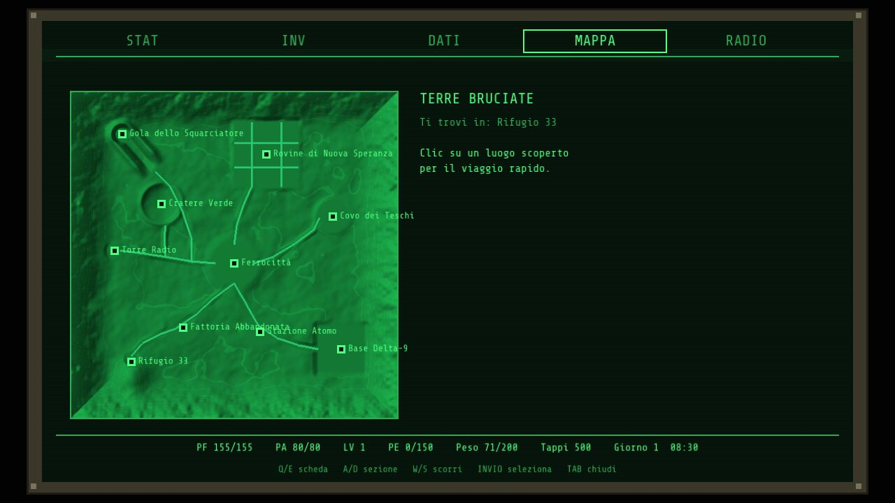
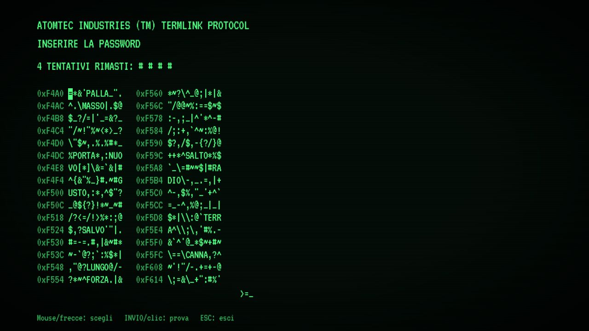

# DUSTFALL — Cronache delle Terre Bruciate

Gioco di ruolo d'azione **3D in prima/terza persona** per **Windows**, ambientato in un mondo
post-apocalittico in stile *Fallout*: un abitante di un Rifugio antiatomico esce per la prima volta
nelle Terre Bruciate per salvare la propria casa.


| | |
|---|---|
|  |  |
|  |  |
|  |  |
|  |  |

## Come giocare

1. Scarica **[`release/Dustfall.exe`](release/Dustfall.exe)** (un unico file, nessuna installazione).
2. Fai doppio clic. Al primo avvio Windows SmartScreen potrebbe avvisare che l'app non è firmata:
   clicca su *Ulteriori informazioni → Esegui comunque*.

Requisiti: Windows 10/11 a 64 bit e una scheda video con OpenGL 3.3 (praticamente qualsiasi PC
degli ultimi dieci anni). I salvataggi vengono scritti nella cartella `saves` accanto all'eseguibile.

## La storia

Anno 2161. Il reattore a fusione del **Rifugio 33** si sta spegnendo. Il Sovrintendente ti affida
una missione disperata: trovare una cella di fusione sperimentale nella **Base Delta-9**, sigillata
da decenni e sorvegliata da robot impazziti. Lungo la strada incontrerai l'insediamento di
**Ferrocittà**, la banda di predoni di **Teschio**, ghoul, mutanti, radscarafaggi e una bestia
leggendaria nascosta in una gola a nord-ovest.

Il finale cambia in base alle tue scelte e al tuo karma.

### Missioni

- **Il cuore del Rifugio** — la missione principale (con più soluzioni: tessera di Teschio oppure
  violazione del terminale del cancello).
- **Infestazione** — libera la Stazione Atomo dai radscarafaggi.
- **Medicine per Ferrocittà** — recupera i rifornimenti dall'ospedale delle rovine.
- **La bestia della gola** — dai la caccia allo Squarciatore.
- **Segnale nel deserto** — segui un segnale di soccorso captato dalla radio del Pip-Boy.

## Caratteristiche

- Mondo aperto di circa 750×750 metri con 10 luoghi da esplorare: Rifugio 33, Ferrocittà,
  Stazione Atomo, Covo dei Teschi, Rovine di Nuova Speranza, Cratere Verde, Torre Radio,
  Fattoria Abbandonata, Gola dello Squarciatore e Base Delta-9 (con laboratori sotterranei).
- Ciclo giorno/notte con cielo, sole, luna, stelle e nebbia di polvere; luci dinamiche e fuochi.
- Sistema **S.P.E.C.I.A.L.** (Forza, Percezione, Resistenza, Carisma, Intelligenza, Agilità,
  Fortuna), 10 abilità, 22 talenti, livelli fino al 20.
- **S.P.A.T.** (Sistema di Puntamento Assistito Tattico): ferma il tempo, mira a testa, torso
  o gambe con la percentuale di successo e guarda i colpi al rallentatore.
- **Pip-Boy** completo: statistiche, inventario, missioni, mappa con viaggio rapido, radio con
  musica swing generata in tempo reale.
- Armi da fuoco, laser, al plasma, mitragliatrice rotante, armi da mischia e granate.
- Armature (anche l'armatura potenziata), stimpak, Rad-Via, cibo, droghe.
- Radiazioni con contatore Geiger, che riducono i punti ferita massimi.
- Dialoghi a scelta multipla con prove di abilità, mercanti e baratto, karma.
- Minigiochi di **scasso** delle serrature e di **violazione dei terminali**.
- Intelligenza artificiale con furtività, allerta, coperture semplici, fuga.
- Salvataggi (5 slot + automatico + rapido), opzioni, schermo intero.
- Tutto è generato dal codice: modelli 3D, terreno, texture, effetti sonori e musica.
  L'eseguibile è autonomo.

## Comandi

| Tasto | Azione |
|---|---|
| **W A S D** | Muoversi |
| **Mouse** | Guardarsi intorno |
| **Clic sinistro** | Sparare / colpire |
| **Clic destro** | Mirare |
| **R** | Ricaricare |
| **E** | Interagire, parlare, raccogliere, perquisire |
| **Q** | S.P.A.T. (puntamento assistito) |
| **TAB** | Pip-Boy |
| **Shift** | Correre (consuma PA) |
| **C / Ctrl** | Accovacciarsi (furtività) |
| **Spazio** | Saltare |
| **G** | Lanciare una granata |
| **H** | Usare uno stimpak |
| **1–9 / rotella** | Cambiare arma |
| **V** | Prima / terza persona |
| **L** | Luce del Pip-Boy |
| **F5 / F9** | Salvataggio / caricamento rapido |
| **F11** | Schermo intero |
| **ESC** | Pausa |

Nello **S.P.A.T.**: `A/D` cambia bersaglio, `W/S` cambia parte del corpo, `E` o clic mette in
coda un colpo, `INVIO` esegue.

## Compilare dai sorgenti

Il gioco è scritto in C++17 con [raylib 5.5](https://www.raylib.com/), scaricata automaticamente
da CMake.

**Windows (Visual Studio 2022 + CMake):** esegui `build_windows.bat`, oppure:

```bat
cmake -S . -B build -A x64
cmake --build build --config Release
```

**Linux:**

```sh
sudo apt install build-essential cmake libx11-dev libxrandr-dev libxinerama-dev libxcursor-dev libxi-dev libgl1-mesa-dev libasound2-dev
cmake -S . -B build -DCMAKE_BUILD_TYPE=Release && cmake --build build -j
./build/Dustfall
```

**Eseguibile Windows da Linux (MinGW-w64):** `./tools/build_windows_cross.sh`
(richiede il pacchetto `mingw-w64`). Il risultato viene copiato in `release/Dustfall.exe`.

Ogni push viene compilato anche da GitHub Actions (`.github/workflows/build.yml`), che produce
l'eseguibile Windows come artefatto ed esegue un test automatico.

### Test automatico

`Dustfall --selftest` gioca da solo l'intera trama (dialoghi, combattimenti, bottino, tutte le
missioni, salvataggio/caricamento e finale) e verifica che tutto funzioni.
`Dustfall --newgame --zone 0 --pos 0 60 --yaw 180 --time 15 --shot foto.png` scatta uno
screenshot da una posizione qualsiasi.

### Struttura del codice

| File | Contenuto |
|---|---|
| `src/game.h` | Tipi e stato condiviso |
| `src/main.cpp` | Ciclo principale, giorno/notte, transizioni, self-test |
| `src/render.cpp` | Shader di illuminazione e cielo, costruzione delle mesh |
| `src/world.cpp` | Collisioni, raycast, terreno |
| `src/world_build.cpp` | Generazione del mondo, luoghi, interni, PNG |
| `src/entities.cpp` | Creature e PNG: IA, modelli animati, danni |
| `src/player.cpp` | Giocatore, armi, visuale in prima persona |
| `src/combat.cpp` | Effetti, granate, S.P.A.T., oggetti interattivi |
| `src/quests.cpp` | Missioni, dialoghi, terminali |
| `src/pipboy.cpp` | Pip-Boy, inventario, baratto, saccheggio, livelli |
| `src/menus.cpp` | Menu, creazione del personaggio, finale, opzioni |
| `src/minigames.cpp` | Scasso e violazione dei terminali |
| `src/audio.cpp` | Sintesi di effetti sonori, ambiente e radio |
| `src/save.cpp` | Salvataggi e impostazioni |

## Crediti

- [raylib](https://github.com/raysan5/raylib) — licenza zlib/libpng.
- Font [Share Tech Mono](https://fonts.google.com/specimen/Share+Tech+Mono) e
  [VT323](https://fonts.google.com/specimen/VT323) — SIL Open Font License (vedi `assets/fonts`).

*Dustfall* è un progetto amatoriale ispirato alla serie *Fallout*; non è affiliato a Bethesda o
Interplay e non ne usa marchi o risorse.
