# DUSTFALL — Cronache delle Terre Bruciate

Avventura **3D open world in prima/terza persona**, ambientata in un mondo post-apocalittico in
stile *Fallout*, con **scontri e combattimenti non letali**: il blaster stordisce, nessuno muore. Un abitante di un Rifugio antiatomico
esce per la prima volta nelle Terre Bruciate con una fotocamera, un blaster di soccorso,
un po' di astuzia e tanta curiosità.

Si gioca **nel browser, anche da telefono, e in multigiocatore con gli amici**:
**[br1-data.github.io/fallout](https://br1-data.github.io/fallout/)** — oppure con l'eseguibile per Windows.

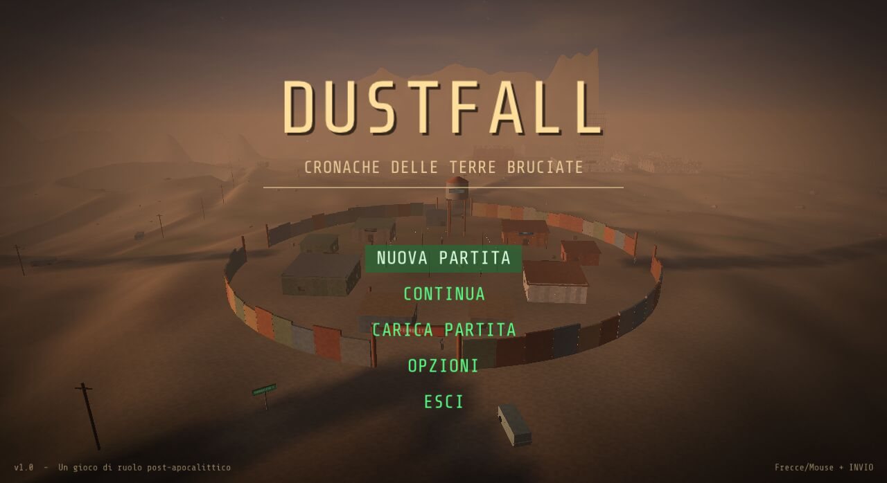

| | |
|---|---|
| 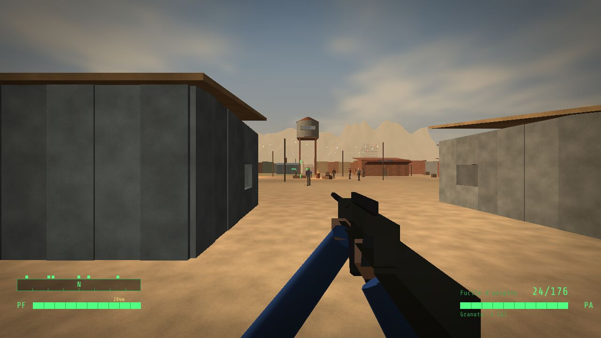 | 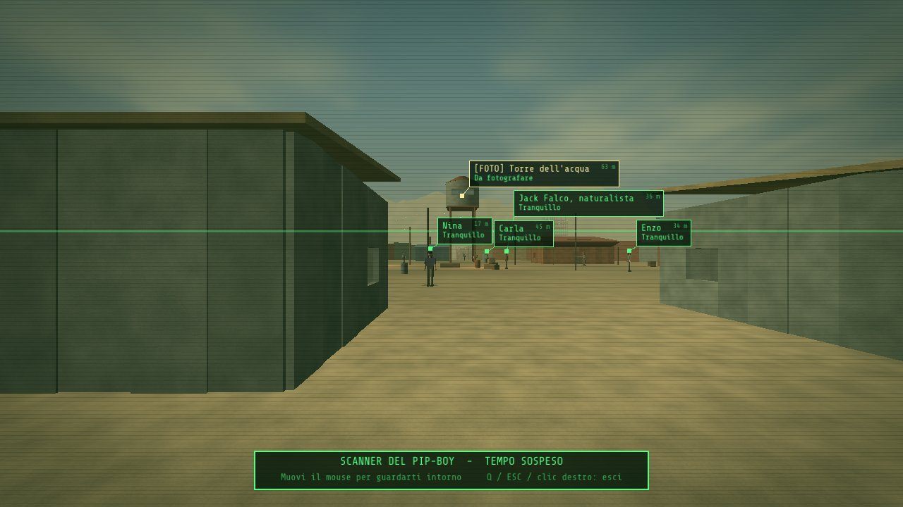 |
| 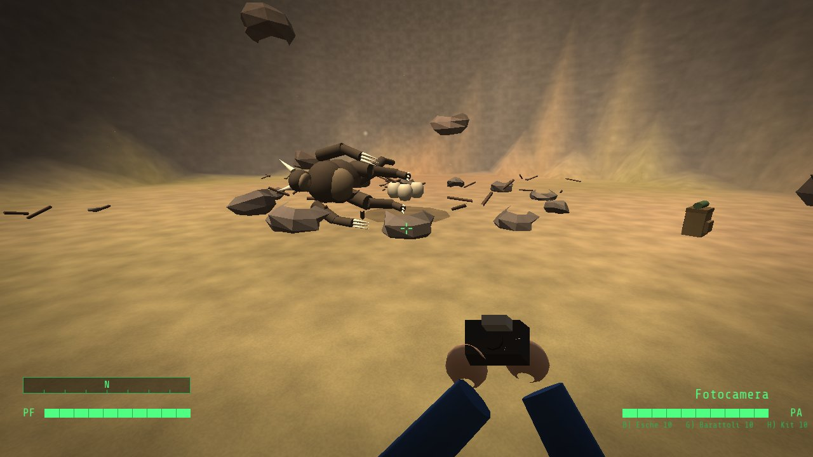 | 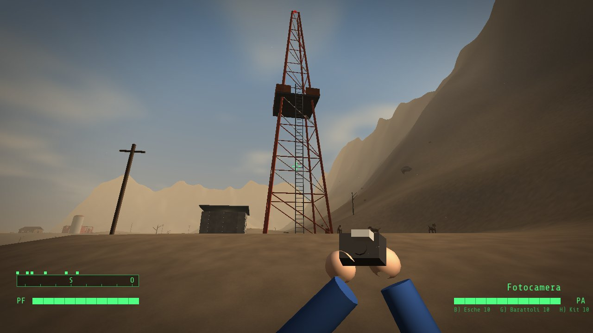 |
| 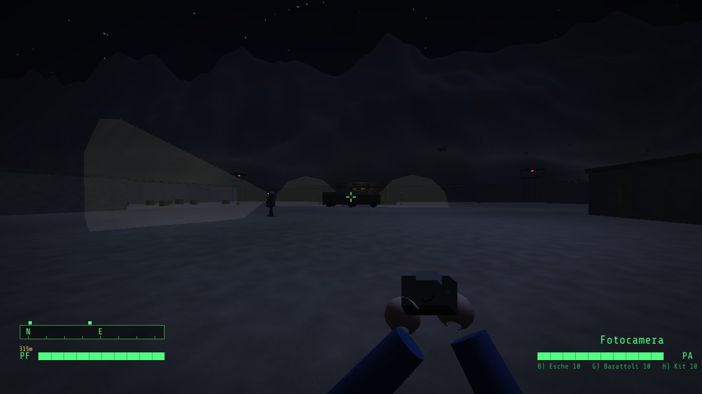 | 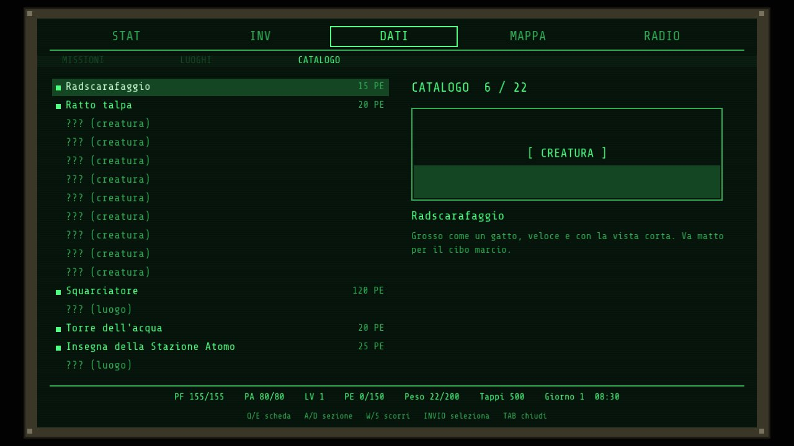 |
| 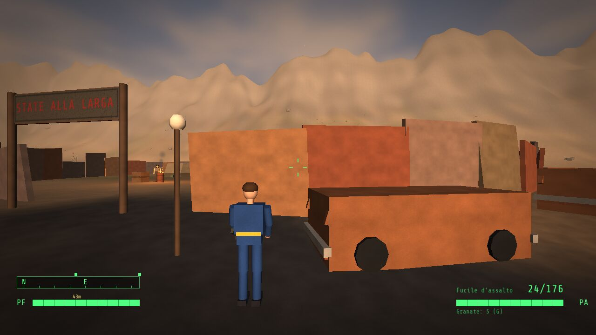 | 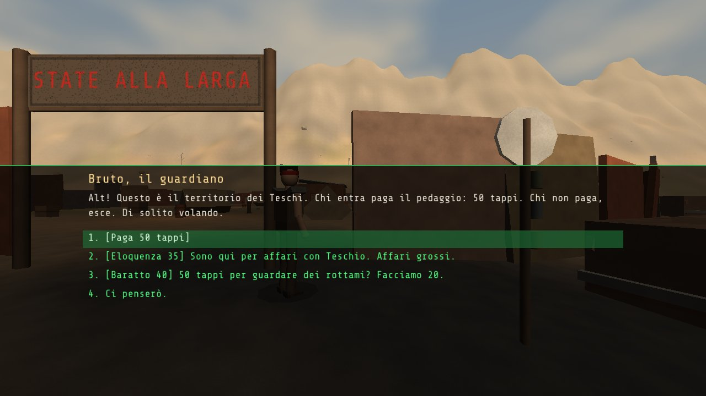 |

## Gioca nel browser (anche con un amico)

1. Apri **[br1-data.github.io/fallout](https://br1-data.github.io/fallout/)** su un computer o su un telefono.
2. Per giocare con un amico premi **Gioca con un amico** nella schermata iniziale: si crea una stanza
   privata e il link si può mandare (su telefono si apre il menu Condividi, su PC si copia). Chi apre il
   link entra nella stessa stanza. Senza stanza privata si gioca nella stanza *pubblica*.
3. Premi **GIOCA**, poi **MONDO APERTO**: si parte alle porte di Ferrocittà, dove ci si ritrova.
   **NUOVA STORIA** comincia invece dentro il Rifugio 33, come nella versione per Windows.

Nel multigiocatore ognuno ha il proprio mondo e le proprie missioni, ma vede gli altri viandanti della
stanza muoversi, salutare e scattare foto, con il nome sopra la testa. Si chatta (**T** o **Invio**, sul
telefono il pulsante **CHAT**), si saluta (**Z**), si vede l'elenco dei giocatori (**P**) e dalla mappa
del Pip-Boy si raggiunge un amico con il viaggio rapido (rombi gialli). Il menu **Multigiocatore** permette
di cambiare stanza e di reinviare l'invito.

**Da telefono o tablet** (Android con Chrome, iPhone/iPad con Safari) compaiono i comandi touch: pollice
sinistro per muoversi (spingendo oltre il cerchio si corre), dito a destra per guardarsi intorno, pulsanti
per usare l'attrezzo, interagire, saltare, accovacciarsi, Pip-Boy, scanner, chat e il resto; nei menu
basta toccare le voci (c'è anche un tastierino). Si gioca in orizzontale. Su Android il gioco va a schermo
intero; su iPhone, per lo schermo intero, *Condividi → Aggiungi alla schermata Home* e apri Dustfall
dall'icona. I salvataggi restano nel browser del dispositivo.

Come funziona la rete, senza un server di gioco: i giocatori della stessa stanza si scambiano piccoli
messaggi sia **direttamente** (WebRTC, quando la rete lo permette) sia tramite **broker MQTT pubblici**
(EMQX e HiveMQ), che funzionano anche dalle reti dei telefoni. Sui broker i messaggi viaggiano cifrati
con una chiave ricavata dal nome della stanza: chi non conosce il nome della stanza non li legge.
La stanza *pubblica* è, appunto, pubblica.

### Spedizioni fotografiche cooperative

Ogni stanza ha una **spedizione di 12 minuti**: tre luoghi delle Terre Bruciate da fotografare
insieme. Il riquadro durante il gioco mostra il tempo rimasto, i soggetti e chi li ha già trovati;
il menu **Multigiocatore** mostra anche i contributi personali della squadra. Dividetevi i luoghi,
usate la chat per coordinarvi e raggiungete gli amici dalla mappa del Pip-Boy.

Servono scatti nuovi, anche se il soggetto è già nel proprio catalogo. Quando tutti e tre i luoghi
sono stati fotografati, ogni partecipante che ha contribuito ottiene **120 PE e 60 tappi**,
una volta per turno e personaggio. Si può contribuire anche dopo il completamento, fino alla
scadenza, oppure tentare la spedizione da soli. Allo scadere parte un nuovo turno con altri
obiettivi; chi entra dopo vede i progressi già condivisi e la partenza di un giocatore non li cancella.
La sfida funziona anche con `?rete=locale`, mentre con `?rete=off` è disattivata.

### Blaster a impulsi e SOS Lucciola

Quando inizi a esplorare le Terre Bruciate ricevi un **blaster di soccorso**: premi **5** per
equipaggiarlo e fai clic per sparare raggi ciano, con lampi, scintille e suono spaziale.
Ogni colpo consuma **8 PA**, che si ricaricano normalmente. Puoi colpire **nemici, persone e
creature**, anche i personaggi amichevoli: rimangono **storditi per 6 secondi** e poi si riprendono.
Sentinelle e telecamere subiscono un sovraccarico temporaneo. Chi e' stordito non può muoversi,
inseguirti o parlare: sfrutta la pausa per passare oppure attendi per continuare il dialogo.
I personaggi delle missioni e i compagni restano in vita e riprendono le proprie attività.
I tuoi amici vedono il blaster e i suoi raggi.
Sul telefono selezionalo con **ATTREZZO** e spara con **USA**.

Nella nuova missione **SOS Lucciola**, un piccolo drone è disperso vicino alla Torre Radio.
Colpisci i globi dei tre ripetitori al cancello di Ferrocittà, alla Stazione Atomo e alla fattoria
abbandonata: sono segnati in ciano sulla mappa del Pip-Boy. I ripetitori attivati dagli amici
nella stessa stanza aiutano tutti, anche chi arriva più tardi. Poi raggiungi il drone e premi **E**:
ottieni **200 PE, 150 tappi e Lucciola come compagno volante**. Il premio è unico per personaggio;
la missione e il blaster restano nel salvataggio. Puoi completarla anche da solo e offline.

| Multigiocatore: l'amico arriva dal telefono | Comandi touch su telefono |
|---|---|
| 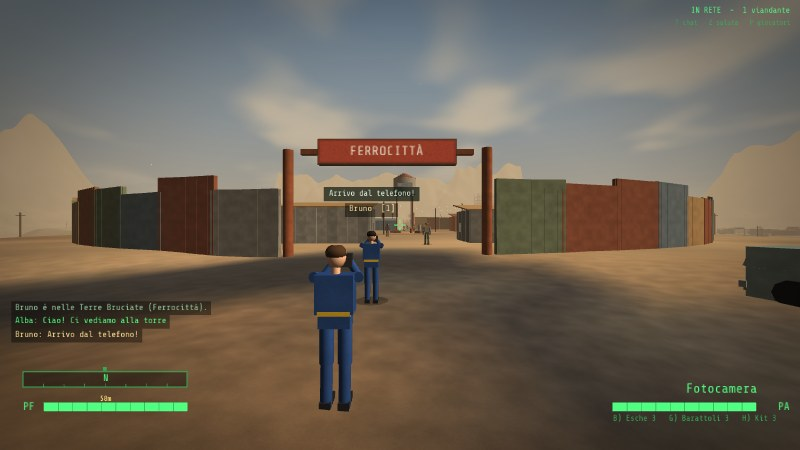 | 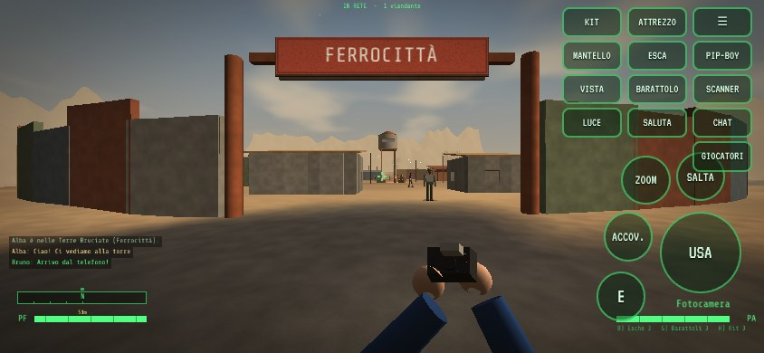 |

## Gioca su Windows

1. Scarica **[`release/Dustfall.exe`](release/Dustfall.exe)** (un unico file, nessuna installazione).
2. Fai doppio clic. Al primo avvio Windows SmartScreen potrebbe avvisare che l'app non è firmata:
   clicca su *Ulteriori informazioni → Esegui comunque*.

Requisiti: Windows 10/11 a 64 bit e una scheda video con OpenGL 3.3 (praticamente qualsiasi PC
degli ultimi dieci anni). I salvataggi vengono scritti nella cartella `saves` accanto all'eseguibile
(i salvataggi della vecchia versione 1.0 non sono compatibili).

## La storia

Anno 2161. Il reattore a fusione del **Rifugio 33** si sta spegnendo. Il Sovrintendente ti affida
una missione disperata: trovare una cella di fusione sperimentale nella **Base Delta-9**, sigillata
da decenni e sorvegliata da sentinelle robotiche che scortano fuori chiunque si avvicini.

Lungo la strada incontrerai l'insediamento di **Ferrocittà**, la banda territoriale di **Teschio**,
un naturalista che sogna di fotografare una bestia leggendaria, un'esploratrice bloccata su una
torre radio e un cane che ha perso la strada di casa.

Il finale cambia in base a come hai risolto le missioni e al tuo karma.

## Scontri nelle Terre Bruciate

Le creature e i guardiani delle Terre Bruciate ti inseguono se ti scoprono e, se ti
raggiungono, ti **scacciano dal loro territorio** (e i Teschi ti alleggeriscono di qualche tappo).
Puoi affrontarli con il blaster oppure osservare, nasconderti, distrarre, convincere e riparare:

- **Fotocamera** — fotografa creature e luoghi notevoli per il catalogo delle Terre Bruciate
  (22 soggetti, ognuno con la sua ricompensa in esperienza). Clic destro per lo zoom.
- **Blaster a impulsi** — mette fuori combattimento persone, nemici e creature per 6 secondi,
  senza ucciderli. I riflessi ciano sopra la testa segnalano chi e' stordito.
- **Furtività** — accovacciati, muoviti al buio, evita i coni di luce delle telecamere. Correre e
  saltare fa rumore; l'indicatore in alto ti dice quando qualcuno è sospettoso.
- **Esche di carne** — attirano animali e bestie, che si fermano a mangiare.
- **Barattoli rumorosi** — lanciali per mandare guardie, mutanti e robot a controllare altrove.
- **Mantello ottico** — mezzo minuto di quasi invisibilità.
- **Scanner del Pip-Boy** — ferma il tempo e mostra chi c'è intorno, cosa sta facendo e come
  aggirarlo, oltre ai soggetti ancora da fotografare.
- **Riparazioni** — pompe, trasmettitori e generatori da rimettere in funzione con kit e ricambi.
- **Scale**, **serrature** da scassinare, **terminali** da violare, **dialoghi** con prove di
  abilità, baratto e accordi.
- **Ruggine**, un cane da salvare che poi ti segue e ringhia piano quando fiuta un pericolo.
- Se i PF finiscono (radiazioni, cadute, stanchezza) **perdi i sensi** e ti risvegli in clinica.

### Missioni

- **Il cuore del Rifugio** — la missione principale. La tessera del cancello si ottiene da Teschio
  con la parlantina, con i tappi, scambiandola con un disco d'anteguerra o rubandola dalla sua
  cassaforte; in alternativa si può violare il terminale del cancello. Dentro la base la Sentinella
  Mk.V si spegne con un codice di manutenzione... o si aggira.
- **Ospiti indesiderati** — porta via i sacchi di cibo marcio che attirano i radscarafaggi.
- **Medicine per Ferrocittà** — recupera i rifornimenti dall'ospedale delle rovine, tra i ghoul.
- **La bestia della gola** — fotografa lo Squarciatore senza svegliarlo.
- **Segnale nel deserto** — aiuta un'esploratrice e ripara il trasmettitore in cima alla torre.
- **Il catalogo di Jack** — otto fotografie per il naturalista di Ferrocittà.
- **Acqua per Ferrocittà** — ripara la pompa dell'acqua della città.
- **Il cane di Rita** — ritrova Ruggine alla fattoria abbandonata.

## Caratteristiche

- Mondo aperto di circa 750×750 metri con 10 luoghi da esplorare: Rifugio 33, Ferrocittà,
  Stazione Atomo, Covo dei Teschi, Rovine di Nuova Speranza, Cratere Verde, Torre Radio,
  Fattoria Abbandonata, Gola dello Squarciatore e Base Delta-9 (con laboratori sotterranei).
- Ciclo giorno/notte con cielo, sole, luna, stelle e nebbia di polvere; luci dinamiche e fuochi.
  Di notte è più facile passare inosservati (a meno di accendere la luce del Pip-Boy).
- Sistema **S.P.E.C.I.A.L.**, 10 abilità (Atletica, Riparazione, Sopravvivenza, Natura, Medicina,
  Scasso, Scienza, Baratto, Eloquenza, Furtività), 22 talenti, livelli fino al 20.
- Intelligenza artificiale con vista, udito, sospetto, inseguimento, ricerca dei rumori, esche,
  allarmi delle telecamere e territori.
- **Pip-Boy** completo: statistiche, attrezzi e inventario, missioni, luoghi, catalogo fotografico,
  mappa con viaggio rapido, radio con musica swing generata in tempo reale.
- Abbigliamento con effetti (furtività, peso trasportabile, eloquenza, radiazioni), kit medici,
  Rad-Via, cibo, caffè e tisane.
- Radiazioni con contatore Geiger, che riducono i punti ferita massimi.
- Minigiochi di **scasso** delle serrature e di **violazione dei terminali**.
- Salvataggi (5 slot + automatico + rapido), opzioni, schermo intero.
- Tutto è generato dal codice: modelli 3D, terreno, texture, effetti sonori e musica.
  L'eseguibile è autonomo.

## Comandi

| Tasto | Azione |
|---|---|
| **W A S D** | Muoversi |
| **Mouse** | Guardarsi intorno |
| **Clic sinistro** | Usare l'attrezzo in mano (scattare, lanciare) |
| **Clic destro** | Zoom della fotocamera |
| **1 / 2 / 3 / 4, rotella** | Mani libere / fotocamera / esca / barattolo |
| **5** | Blaster a impulsi (clic sinistro per sparare) |
| **B** | Lanciare un'esca di carne |
| **G** | Lanciare un barattolo rumoroso |
| **E** | Interagire, parlare, raccogliere, riparare, salire sulle scale |
| **Q** | Scanner del Pip-Boy (ferma il tempo) |
| **TAB** | Pip-Boy |
| **Shift** | Correre (consuma PA, fa rumore) |
| **C / Ctrl** | Accovacciarsi (furtività) |
| **Spazio** | Saltare |
| **H** | Usare un kit medico |
| **F** | Attivare un mantello ottico |
| **V** | Prima / terza persona |
| **L** | Luce del Pip-Boy |
| **F5 / F9** | Salvataggio / caricamento rapido |
| **F11** | Schermo intero |
| **ESC** | Pausa (nel browser ESC libera il mouse e mette in pausa) |
| **T / Invio** | Chat (versione web) |
| **Z** | Saluta gli altri giocatori (versione web) |
| **P** | Elenco dei giocatori nella stanza (versione web) |

Nel browser per accovacciarsi si usa solo **C** (Ctrl+W chiuderebbe la scheda).

## Compilare dai sorgenti

Il gioco è scritto in C++17 con [raylib 5.5](https://www.raylib.com/), scaricata automaticamente
da CMake.

**Windows (Visual Studio 2022 + CMake):** esegui `build_windows.bat`, oppure:

```bat
cmake -S . -B build -A x64
cmake --build build --config Release
```

**Linux:**

```sh
sudo apt install build-essential cmake libx11-dev libxrandr-dev libxinerama-dev libxcursor-dev libxi-dev libgl1-mesa-dev libasound2-dev
cmake -S . -B build -DCMAKE_BUILD_TYPE=Release && cmake --build build -j
./build/Dustfall
```

**Eseguibile Windows da Linux (MinGW-w64):** `./tools/build_windows_cross.sh`
(richiede il pacchetto `mingw-w64`). Il risultato viene copiato in `release/Dustfall.exe`.

**Versione web (WebAssembly):** con [Emscripten](https://emscripten.org/) 3.1.74 attivo
(`source <emsdk>/emsdk_env.sh`) esegui `./tools/build_web.sh`; il sito pronto è in `build-web/site`
(per provarlo: `cd build-web/site && python3 -m http.server 8000`). Parametri utili nell'indirizzo:
`?rete=locale` fa parlare tra loro le schede dello stesso browser, `?touch=1` forza i comandi touch,
`?mqtt=ws://...` e `?relay=wss://...` usano broker MQTT o relay Nostr propri.

Ogni push viene compilato anche da GitHub Actions: `.github/workflows/build.yml` produce
l'eseguibile Windows ed esegue il test automatico su Linux; `.github/workflows/pages.yml` compila la
versione web, esegue lo stesso test dentro Chromium e, dal ramo `main`, la pubblica su GitHub Pages
(da attivare una volta in *Settings → Pages → Source: GitHub Actions*).

### Test automatico

`Dustfall --selftest` gioca da solo l'intera trama (dialoghi, fotografie, esche, barattoli, essere
scacciati, riparazioni, scale, terminali, tutte le otto missioni, svenimento, salvataggio/caricamento,
finale e partenza in mondo aperto) e verifica che tutto funzioni. Nella versione web lo stesso test si
avvia con `index.html?rete=off&args=--selftest`, oppure con `node tools/web_selftest.js build-web/site`.
`Dustfall --newgame --zone 0 --pos 0 60 --yaw 180 --time 15 --shot foto.png` scatta uno
screenshot da una posizione qualsiasi.

### Struttura del codice

| File | Contenuto |
|---|---|
| `src/game.h` | Tipi e stato condiviso |
| `src/main.cpp` | Ciclo principale, giorno/notte, transizioni, self-test |
| `src/render.cpp` | Shader di illuminazione e cielo, costruzione delle mesh |
| `src/world.cpp` | Collisioni, raycast, terreno |
| `src/world_build.cpp` | Generazione del mondo, luoghi, interni, PNG |
| `src/entities.cpp` | Creature e PNG: vista, udito, inseguimenti, distrazioni, modelli animati |
| `src/player.cpp` | Giocatore, attrezzi, fotografia, visuale in prima persona |
| `src/fx.cpp` | Effetti, oggetti lanciati, scanner del Pip-Boy |
| `src/interact.cpp` | Oggetti interattivi: contenitori, porte, scale, riparazioni |
| `src/quests.cpp` | Missioni, dialoghi, catalogo fotografico, terminali |
| `src/pipboy.cpp` | Pip-Boy, inventario, baratto, saccheggio, livelli |
| `src/menus.cpp` | Menu, creazione del personaggio, svenimento, finale, opzioni |
| `src/minigames.cpp` | Scasso e violazione dei terminali |
| `src/audio.cpp` | Sintesi di effetti sonori, ambiente e radio |
| `src/save.cpp` | Salvataggi e impostazioni |
| `src/platform.cpp` | Differenze tra desktop e browser: puntatore, schermo intero, salvataggi, touch |
| `src/net.cpp` | Multigiocatore: altri giocatori, nomi, chat, menu della stanza, mappa |
| `web/index.html` | Pagina del gioco: schermata iniziale, inviti, caricamento |
| `web/net.js` | Rete: broker MQTT cifrati e WebRTC diretto (Trystero) |
| `web/touch.js` | Comandi touch e finestra per scrivere su telefono |

## Crediti

- [raylib](https://github.com/raysan5/raylib) — licenza zlib/libpng.
- [Emscripten](https://emscripten.org/) per la versione web.
- [Trystero](https://github.com/dmotz/trystero) e [@noble/secp256k1](https://github.com/paulmillr/noble-secp256k1)
  — licenza MIT (in `web/trystero.min.js`, rigenerabile con `tools/build_trystero.sh`).
- Font [Share Tech Mono](https://fonts.google.com/specimen/Share+Tech+Mono) e
  [VT323](https://fonts.google.com/specimen/VT323) — SIL Open Font License (vedi `assets/fonts`).

*Dustfall* è un progetto amatoriale ispirato alla serie *Fallout*; non è affiliato a Bethesda o
Interplay e non ne usa marchi o risorse.
